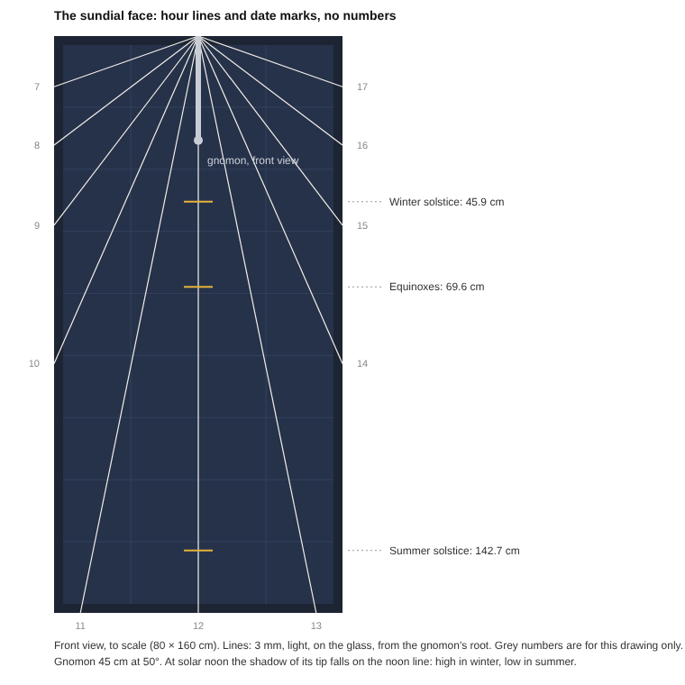

# The gnomon: the sundial and mounting

Each PVA panel is also a real vertical sundial. It reads the same solar time as the digital dial on the visitor's phone: solar noon at the top, morning on the left, afternoon on the right. The digital dial is drawn by the panel's data; the sundial is read from the gnomon's shadow on the glass. Two dials, one sun.

> Status: design, not yet built. **29 Oct 2026: the face simplified:** hour lines on the glass with **no numbers and no hour brackets**, and three **date marks** on the noon line for the solstices and equinoxes; the gnomon shortened to **45 cm** so all three marks fall on the glass ([The face](#the-face-lines-and-date-marks)). All figures are for Bosa (latitude 40.3° N), a vertical panel facing due south, 80 × 160 cm in portrait, and a June exhibition. See [Reusing the panels](#reusing-the-panels) before building for anything else.

## Principles

- **Nothing is fixed through the glass.** Everything that carries load bolts to the aluminium frame; the only things on the glass are the lines and marks, applied like a sticker and removable.
- **One material.** Gnomon mount and stand-offs are both cut from the same aluminium angle stock.
- **Bolted and demountable.** M6 stainless bolts, washers and nuts through 6.5 mm holes. No rivets, no glue.
- **Every panel identical.** Same gnomon, same lines and marks, same template. Walls that are not quite south-facing are handled by packing one edge out (see [Installation](#installation)), never by changing the dial.

## Parts

| Part | Specification |
| --- | --- |
| Panel | Trina Solar TSM-185DC01: 80 × 160 cm measured (label: 1581 × 809 × 40 mm, 15.6 kg), portrait, vertical, facing due south. Frame depth 40 mm |
| Gnomon | 15 mm OD aluminium tube, **45 cm** long, mitred and TIG-welded to an aluminium angle mount; two M6 bolts through the top frame flange |
| Gnomon angle | **50°** from the glass, pointing down and out, exactly on the panel's vertical centre line (ideal for Bosa: 49.7°) |
| Hour lines | 11 lines on the glass, solar hours 7 to 17, radiating from the gnomon's root to the frame edge. **No numbers.** 3 mm wide, a light colour, in UV-stable outdoor vinyl pinstripe tape, removable |
| Date marks | 3 short ticks across the noon line, 8 cm wide, in the same tape: winter solstice, equinoxes, summer solstice ([Date marks](#date-marks)) |
| Stand-offs | Aluminium angle, four per panel: two short on one long edge, two long on the other, cut to the measured depth |
| Fasteners | M6 stainless bolts, nuts, flat and lock washers |
| Tip cap | A cap on the gnomon's free end: it projects about 35 cm from the wall |

## Why 50° and why on the centre line

A sundial keeps time all year only if its gnomon is parallel to the Earth's axis. On a vertical, south-facing face that means the gnomon lies in the north–south plane (on the panel's centre line, not leaning sideways) and meets the face at 90° minus the latitude: 90 − 40.3 = 49.7°. 50° is within 0.3°, close enough for a public sundial.

## The face: lines and date marks

The face is as plain as the panel: **lines, no numbers.**

- **Hour lines:** one line for each solar hour from 7 to 17, radiating from the gnomon's root at the top centre. The noon line runs straight down the middle. The 6 and 18 lines lie along the top edge of the frame and are left out.
- **No numbers and no hour brackets.** Noon is the vertical line; the hours count out from it, morning on the left. Anyone who wants the hour counts the lines.
- **Date marks:** three short ticks across the noon line, where the shadow of the gnomon's tip falls at solar noon: the winter solstice nearest the top (the shortest noon shadow), the summer solstice nearest the bottom (the longest), and the equinoxes between ([Date marks](#date-marks)).
- **Reading it:** the shadow of the rod lies along an hour line and gives the solar time; at noon, the end of the shadow shows the season.

The lines are read along their length, so the gnomon no longer has to reach brackets at the frame's edge: that is what lets it be shorter (45 cm instead of 60), with less reach from the wall.

**To test on the artist's proof:** the tape shades a thin strip of cells. Measure the panel's short-circuit current near solar noon with and without the lines (expected: a small loss), and check that the lines read well from the street. If the tape fails, the fallback is plain, unnumbered brackets on the frame edge, as in the first design, with the date marks on a thin strip along the noon line.

## Hour lines

The dial reads **solar time**, not clock time. Each hour line's angle from the vertical noon line, for a vertical south dial in Bosa:

| Solar time | Angle from the noon line |
| --- | --- |
| 12:00 | 0° (straight down) |
| 11:00 / 13:00 | 11.6° |
| 10:00 / 14:00 | 23.8° |
| 9:00 / 15:00 | 37.3° |
| 8:00 / 16:00 | 52.9° |
| 7:00 / 17:00 | 70.6° |
| 6:00 / 18:00 | 90° (horizontal) |

Formula: tan(angle) = cos(latitude) × tan(15° × hours from noon).

Do **not** set the hour lines against a clock on site. Clock time includes summer time and the equation of time, so marks set "on the hour" would be off by up to about 16 minutes on other days, and an hour in winter.

## Line template

For an 80 × 160 cm panel in portrait. Each line runs from the gnomon's root (where its axis meets the face, at the centre of the top edge) to the point below where it meets the frame edge. Morning is on the left as you face the panel. The template is mirrored, so one template serves both sides, and all nine panels are lined identically on the bench. The only holes drilled are for the gnomon's mount and the stand-offs.

| Solar hour | Where the line meets the frame edge |
| --- | --- |
| 7 / 17 | side edges, 14.1 cm down from the top |
| 8 / 16 | side edges, 30.3 cm down |
| 9 / 15 | side edges, 52.4 cm down |
| 10 / 14 | side edges, 90.8 cm down |
| 11 / 13 | bottom edge, 7.3 cm in from each corner |
| 12 | bottom edge, centre |

Apply the tape on clean, dry glass, from the root outwards, stopping at the inner edge of the frame. Drill only the frame's outer flange (for the gnomon mount and stand-offs), well clear of the channel holding the glass, and deburr every hole.

The template above is for an 800 × 1600 mm frame. The label gives 809 × 1581 mm; if a frame measures that, use:
7/17 at 14.2 cm, 8/16 at 30.6 cm, 9/15 at 53.0 cm, 10/14 at 91.9 cm down the sides, and 11/13 on the bottom edge
8.1 cm in from each corner. The angles do not change; only where each line meets the frame edge. The date marks do not change either: they are measured from the root.

## Gnomon length

**45 cm.** With lines on the glass the shadow is read along a line, so the gnomon only needs to be long enough to cast a clear shadow, and short enough for **all three date marks to fall on the glass**: the shadow of the tip at noon on the summer solstice falls 142.7 cm below the root, inside the 160 cm panel. (With the earlier 60 cm gnomon it would fall at 190 cm, below the panel.)

- **Safety:** at 45 cm the gnomon projects about 35 cm from the wall (46 cm before). Mount it well above head height, with its end capped.
- **The tip is the marker.** The date marks are set for the shadow of the gnomon's tip, so the tip cap must keep the tube's line and end exactly at 45 cm.

## Date marks

At solar noon the sun is due south, and the shadow of the gnomon's tip falls on the noon line. How far down depends on how high the sun is, which depends on the date. Measured down the noon line from the gnomon's root, for Bosa (latitude 40.3° N), a 45 cm gnomon at 50°:

| Mark | Sun at noon | Below the root |
| --- | --- | --- |
| **Winter solstice** (about 21 December) | 26.3° high | **45.9 cm** |
| **Equinoxes** (about 20 March, 22 September) | 49.7° high | **69.6 cm** |
| **Summer solstice** (about 21 June) | 73.1° high | **142.7 cm** |

Formula: distance = L × cos 50° + L × sin 50° × tan(sun's height at noon), with L the gnomon's length and the sun's height at noon = 90° − latitude + the sun's declination (+23.44° in June, 0° at the equinoxes, −23.44° in December).

- **The winter mark is the shortest noon shadow, the summer mark the longest:** on a vertical wall the high summer sun throws the shadow far down.
- **The equinox mark is not halfway between the two.** The shadow moves slowly near the winter mark and quickly towards summer; 69.6 cm is right.
- **Through the year** the tip's noon shadow travels from the winter mark down to the summer mark and back, crossing the equinox mark twice: a calendar as well as a clock.
- **Check on the artist's proof** at the next solstice or equinox: the tip's shadow at solar noon should touch the mark.

## Installation

Like a satellite dish: everything is prepared on the bench, and on site you only aim it.

1. **On the bench.** Apply the hour lines and date marks from the one template; drill the frame and fit the gnomon and the stand-off brackets.
2. **On site.** Measure the wall with the noon-shadow test below. It tells you which long edge to pack out and by how much.
3. **Set the stand-offs.** Two short ones on one long edge, two long ones on the other, cut to the measured depth. The panel ends up vertical and facing due south, whatever the wall does.
4. **Hang and check.** A spirit level against the glass for vertical. At the next solar noon, the gnomon's shadow should fall straight down the noon line. If it lands to one side, adjust the long stand-offs until it doesn't.

The deep side of the wedge is a natural home for the electronics box: shaded, ventilated and out of sight.

### How far the edge packs out

Stand-off depth for an 80 cm wide panel:

| Wall's angle off south | Edge packs out by |
| --- | --- |
| 5° | about 7 cm |
| 10° | about 14 cm |
| 15° | about 21 cm |
| 20° | about 29 cm |

Up to about 20° off south this works well. Beyond that the panel stands out from the wall like an opening door and the fixings carry real wind load: choose another wall, or a post turned to face due south ([POST.md](POST.md): the free-standing panel, for private ground with no suitable wall). From the side the wedge is visible; where litter or nesting birds could collect in the gap, close its open side with a light screen.

## Testing a wall: the noon-shadow test

About twenty minutes around solar noon on a clear day. Needs a plumb line (or a straight rod and a spirit level), a carpenter's square, a tape measure and chalk. Test every candidate wall before deciding where the panels go.

A compass gives a first rough reading: hold it flat with its straight edge against the wall, read the bearing along the wall towards your right as you face it, add 90° (the direction the wall faces), then add 3° (magnetic north in Sardinia lies about 3° east of true north). Metal in and near walls often throws a compass off, so the shadow is the measurement that counts.

1. **Set up a few minutes before solar noon.** The square on level ground, one arm flat against the wall base, the other pointing straight out. Hang the plumb line a little in front of the wall, so its shadow falls on the ground towards the wall.
2. **At the exact minute of solar noon,** mark the shadow's line in chalk. It runs true north–south. Be exact: near noon in summer the shadow swings about a degree a minute.
3. **Measure 1 m out along the square's arm,** then the sideways gap from the arm to the shadow line.
4. **Which edge.** Facing the wall: shadow to your right of the square, pack out the left edge; shadow to your left, pack out the right edge. No gap: the wall faces due south.
5. **How far.** Stand-off depth = panel width × gap ÷ 100 cm. A 17.5 cm gap with the 80 cm panel gives 14 cm. No angles needed.
6. **Is the wall usable?** A gap of up to about 36 cm (20° off south) is fine. Beyond that, look elsewhere.

### Solar noon in Bosa (clock time)

| Date | Solar noon |
| --- | --- |
| 20 Oct 2026 | 13:12 |
| 1 Nov 2026 (winter time) | 12:11 |
| 1 Dec 2026 | 12:16 |
| 1 Jan 2027 | 12:30 |
| 1 Feb 2027 | 12:41 |
| 1 Mar 2027 | 12:40 |
| 1 Apr 2027 (summer time) | 13:31 |
| 1 May 2027 | 13:24 |
| 1 Jun 2027 | 13:25 |
| 21 Jun 2027 | 13:29 |

Between these dates it changes by at most a minute or two per week. For any other day, solar noon is exactly halfway between sunrise and sunset; `sun_times()` in `tools/pva_rules.py` calculates it for any date.

## What vertical mounting means for the data

- **The sun reaches a vertical south face for fewer hours in summer.** From 6:00 to 18:00 solar time only at the equinoxes. On 21 June the sun reaches the face only from about 8:00 to 16:00 solar time (about 9:30 to 17:30 by the clock); before and after, it is behind the panel. So in June each ring's first and last three and a half hours can never be sunny, and print blue: in the dial, blue simply means this panel was not in the sun, for whatever reason.
- **Because every panel faces exactly south,** this is the same on all nine, and any difference between their dials comes purely from place.
- **Summer noon sun strikes the glass steeply,** so a vertical panel gives roughly a third of its rated power at noon: still far more than the board needs. The sun rule is calibrated against each panel's own clear-noon current, so it is unaffected.
- **The gnomon's shadow crosses the cells** and causes a small, regular dip in the panel's current each day, too small to change a section's colour.
- **The lines and marks shade a thin strip of cells** all the time: a small, constant loss, measured on the artist's proof and taken into each panel's own calibration.

## Reusing the panels

Everything above is calculated for Bosa, a June exhibition and a due-south vertical face. Before using the panels in a different season or place, recalculate:

- **The date marks:** their distances from the root, from the formula in [Date marks](#date-marks), and whether the summer mark still falls on the glass (if not, a shorter gnomon).
- **At another latitude:** the gnomon angle (90° − latitude), the hour-line angles and the line template.
- **The solar-noon times** for the noon-shadow test.
