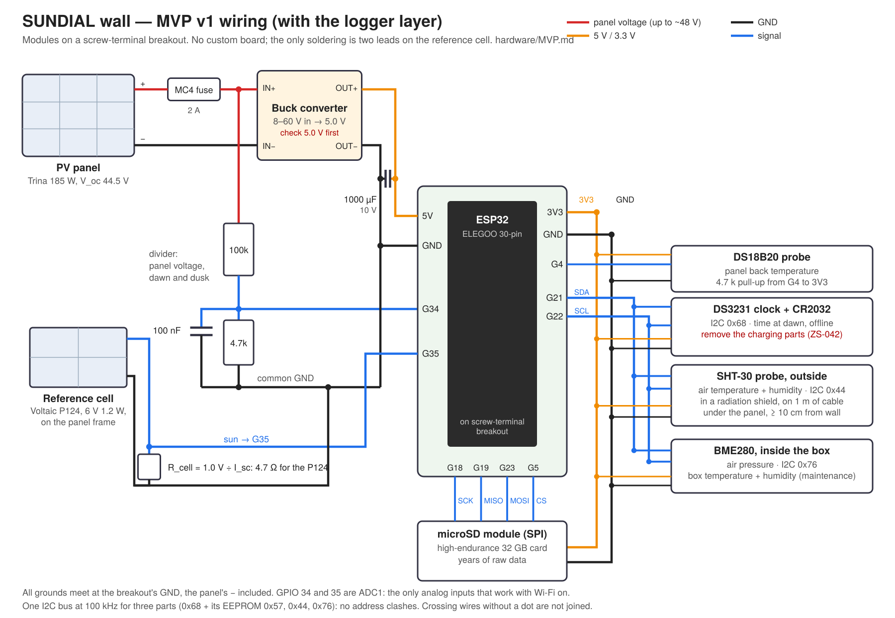

# SUNDIAL wall — MVP v1

**The build for every SUNDIAL panel:** a recycled PV panel that is a sundial, makes the daily dial, and logs its wall's sun and weather for years. Off-the-shelf modules on a screw-terminal breakout: no PCB to design, and no soldering except two leads on the reference cell. Any town can build it from this page.

> Status: **v1, 25 Nov 2026: the final shape of the first version.** This is the starting point for the build; the build order and the open tasks are in [MVP-TASKS.md](../MVP-TASKS.md). It replaces drafts 1 (31 Oct) and 2 (25 Nov, which added the logger layer). The same build serves SUNDIAL's walls in year 1 and every SUNSET node in year 2 (interactive nodes add a battery, section 10). The carrier board ([CARRIER.md](CARRIER.md), [carrier/](carrier/README.md)) is **on hold**, kept complete and quoted for the day the module build proves too fragile outdoors.

---

## 1. What the panel does

| Job | How | For |
| --- | --- | --- |
| **Sundial** | Gnomon, hour lines and date marks on the glass ([GNOMON.md](GNOMON.md)) | Anyone passing, always |
| **The daily dial** | Sun, temperature and visits drawn as one sealed image at sunset (rules-1, SUNDIAL.md) | The event, the print, the Sun page |
| **The long-term logger** | Every minute while awake: sun, air temperature, humidity, pressure, panel heat and voltage, kept for years on a card | The historical record and the SUNDIAL network ([DATA.md](../DATA.md)) |
| **The page** | Its own Wi-Fi access point and captive-portal page, no internet | Visitors' phones at the wall |

**What it never does:** run at night (no battery, by design: SUNDIAL.md 1), connect to the internet, or claim energy produced. The panel powers only its own work.

## 2. Parts, per wall

| # | Part | Job | Notes |
| --- | --- | --- | --- |
| 1 | **Recycled PV panel** (Trina TSM-185DC01) | Power | V_oc ≤ 50 V, ≥ 20 W (CARRIER.md, *Panel compatibility*). The panel is not the sun sensor, so its current is no limit |
| 2 | **Inline MC4 fuse holder (10×38) with a 2 A gPV fuse** | Safety | On the panel's + lead. Holders usually come with 10–30 A fuses: buy 2 A gPV 10×38 fuses separately (e.g. Eaton PV-2A10F). MC4 connectors are polarised: the panel cannot be wired backwards |
| 3 | **Buck converter, 8–60 V in → 5 V** (generic module) | Power | **Check the output is 5.0 V with a multimeter before connecting anything**; if it is adjustable, set it to exactly 5.0 V |
| 4 | **1000 µF / 10 V capacitor** on the 5 V input | Holds up Wi-Fi peaks and the card's last write at dusk | |
| 5 | **ELEGOO ESP32 30-pin** (USB-C) | The wall | Original ESP32, 4 MB flash |
| 6 | **Screw-terminal breakout** for the 30-pin ESP32 | Every wire in a screw terminal | Check it fits the ELEGOO's row spacing before buying nine |
| 7 | **DS3231 clock module + CR2032** | Time at dawn, offline | **Remove the charging part** on "ZS-042" modules (a diode and a 200 Ω resistor near the cell holder), or buy one without a charger |
| 8 | **Reference solar cell: Voltaic P124**, 6 V 1.2 W, ETFE (113 × 66 mm, I_sc 0.22 A) | The sun sensor | Rated for 5–7 years outdoors, unlike cheap epoxy mini panels. Solder pads: fit short leads once, before mounting (the one soldering job). Any multi-cell 6 V panel works; not a single 0.5 V cell (4.1) |
| 9 | **Cell resistor**, 1 %, ¼ W: **4.7 Ω** for the P124 (4.1) | Turns the cell's current into a voltage | Across the cell's leads, at the terminals |
| 10 | **DS18B20 waterproof probe** + 4.7 kΩ pull-up | Panel temperature | On the panel back, centre |
| 11 | **Divider: 100 kΩ and 4.7 kΩ, 1 %**, + 100 nF | Panel voltage; the dawn and dusk gates | |
| 12 | **SHT-30 weatherproof probe** (Adafruit 4099: sintered-mesh head, 1 m cable, bare wires) | Air temperature and humidity (±0.5 °C, ±2 % RH) | In part 13, never in the box, never touching the panel. I2C 0x44. Wires: red VCC, black GND, yellow SCL, green or blue SDA (swap SDA and SCL if it does not answer) |
| 13 | **Radiation shield**, 5–8 plates | Keeps sun and wall heat off the air probe | Bought, or 3D-printed in ASA |
| 14 | **BME280 module** (I2C), from a reputable seller | Air pressure; box temperature and humidity | Inside the box. Pressure is the same inside a vented box; box humidity says when the desiccant is spent. Cheap "BME280" modules are often BMP280s with no humidity: the BME280 chip is square, the BMP280 oblong |
| 15 | **microSD module (SPI, 3.3 V)** + **high-endurance microSD, 32 GB** (SanDisk High Endurance SDSQQNR-032G-GN6IA: −25 to 85 °C) | Years of raw data | 32 GB is SDHC, so it formats as FAT32, which the ESP32 reads. Consumer camera-grade card: the dusk write (5) protects it from power loss. **If the dusk test or the winter (7) shows corrupted files, use an industrial card** (with power-loss protection in its firmware, about €42–65) for the nine |
| 16 | **IP65 box** (about 115 × 90 × 55 mm), 4–5 cable glands, a breather vent, a desiccant pack | Housing | Glands: panel, reference cell, DS18B20, air probe, spare |
| 17 | Wire ferrules, short wires, standoffs | Assembly | Ferrules on every stranded wire into a screw terminal |

**Optional, only if testing asks for them:** two 10 F supercaps in series, if dusk brownouts misbehave.

**Rough cost** without the panel: about **€190 per wall** (Nov 2026), the largest items being the air probe (about €26), the shield (about €25, or €5 printed in ASA) and the box (about €25). The budget ([budget/](../budget/)) has the line-by-line figures and sources.

## 3. Wiring



*Drawing: [mvp-wiring.svg](mvp-wiring.svg), generated by `tools/mvp_wiring.py`. The text version:*

```
panel + ── MC4 fuse 2 A ──┬── buck IN+        buck OUT+ (5.0 V) ──┬── breakout 5V
panel − ──────────────────┼── buck IN−        buck OUT− ──────────┼── breakout GND
                          │                                  1000 µF between them
                          └── 100 k ──┬── GPIO 34              (panel voltage)
                                     4.7 k ── GND
                                     100 nF ── GND

reference cell + ──┬── GPIO 35                                  (sun)
                   R_cell
reference cell − ──┴── GND

DS18B20: red 3V3 · black GND · yellow GPIO 4, 4.7 k from GPIO 4 to 3V3   (panel temperature)
DS3231:  VCC 3V3 · GND · SDA GPIO 21 · SCL GPIO 22   (I2C 0x68, 0x57)    (clock)
SHT-30:  VCC 3V3 · GND · SDA GPIO 21 · SCL GPIO 22   (I2C 0x44)          (air temperature, humidity)
BME280:  VCC 3V3 · GND · SDA GPIO 21 · SCL GPIO 22   (I2C 0x76)          (pressure, box health)
microSD: VCC 3V3 · GND · SCK GPIO 18 · MISO GPIO 19 · MOSI GPIO 23 · CS GPIO 5   (storage)
```

- **All grounds meet at the breakout's GND,** the panel's − included.
- **GPIO 34 and 35 must stay as they are:** they are on ADC1, the only analog inputs that work with Wi-Fi on.
- **One I2C bus, three parts, no address clashes.** Run it at 100 kHz; the air probe's 1 m cable is fine at that speed. If readings drop out, shorten the cable before anything else.
- The divider's top resistor sits at panel voltage (up to about 48 V): keep its terminal apart from the 3.3 V side, and keep the panel leads away from the ESP32's antenna end.

## 4. The sensors

### 4.1 The reference cell (sun)

The sun is measured by a small cell on the panel's frame, not by the big panel. It is read **near short circuit**, where its current rises in proportion to the light; the resistor turns that current into a small voltage, well below the cell's working voltage, so the cell stays linear.

- **R_cell = 1.0 V ÷ the cell's label I_sc.** The P124's I_sc of 0.22 A gives 4.5 Ω: fit **4.7 Ω** (full sun about 1.03 V). For other cells: I_sc 180 mA → 5.6 Ω; I_sc 100 mA → 10 Ω. Under 0.2 W in the resistor.
- Full sun gives about 1.0 V at GPIO 35, read at the **2.5 dB range** (about 0.1–1.25 V), where the ESP32 is most accurate. A vertical wall's clear noon gives less; the dial's threshold (a third of clear noon) stays well above 0.1 V.
- **Placing it:** in the panel's plane, facing the same way, fixed to the frame without shading the panel; at the edge most like the panel's average light (where shadows cross the wall, the side the shadow reaches first or last, as the artist's proof shows). Its lead enters through its own gland with a drip loop. Clean it when the panel is cleaned.
- **What it means for the dial:** the dial records sun on the cell, at one edge of the panel. On a clear wall that is the same as the whole panel; where a shadow crosses, a few sections at its edge can differ.

### 4.2 The air probe and its shield

Under the panel's lower edge, **at least 10 cm from the wall and the panel**, out of the panel's afternoon re-radiation, with the cable in its own gland. The readings are **this wall's microclimate**, not a standard weather station's: a wall is warm, sheltered and shades itself. That is the point (same sun, different data), and the website says so.

### 4.3 The others

| Sensor | Where | Note |
| --- | --- | --- |
| DS18B20 | Panel back, centre | Panel temperature for the dial's line and the logger |
| Divider | In the box | Panel voltage, close to open circuit (the board draws under 1 W from 185 W); the dawn and dusk gates |
| BME280 | In the box | Pressure for the logger; box temperature and humidity for maintenance only |
| DS3231 | In the box | Its own temperature sensor is a free second box reading |

### 4.4 What the panel adds by itself

- **Panel heating** = panel temperature − air temperature, at a given sun. Still days run hot, wind cools: over a year, a wind index for the wall without an anemometer.
- **The panel's ageing:** its voltage corrected to 25 °C, on clear middays, year on year. A coarse measure (voltage shows ageing less than current or power), but the panel's own story, told by itself.

### 4.5 Not fitted, and why

Rain (a gauge needs an open site and power at night) · wind (an anemometer on a wall measures the wall; 4.4 does better here) · separate light or UV sensors (the reference cell already measures the sun).

## 5. Storage and power

- **The card is the original record:** one CSV per day, one row per minute while awake, about 15 MB a year at summer rates; a 16 GB card holds decades. File layout and columns: [DATA.md](../DATA.md) 3.
- **LittleFS** (the ESP32's own flash) keeps what it holds now: the event archives and recent logs. The panel still works if the card fails.
- **The dusk write:** the wall loses power at dusk with no warning other than the falling panel voltage. The firmware stops writing to the card at a set voltage above the dusk gate, writes the day's hash, closes the file, and only then runs the dusk close. Every line is appended and the file closed after each write, so a sudden loss costs one line at most. The 1000 µF capacitor covers the last write.
- **Daylight only.** The night is missing; the day's minimum temperature usually comes just before dawn, so the first reading at wake is close to it. A full 24-hour record needs the battery tier (section 10).
- **Collection:** the fortnightly round downloads as before. With the card, **a missed round, or several, loses nothing.**

## 6. Firmware

The MVP build of firmware 6.2 (SUNDIAL.md), with these build flags:

| Flag | Meaning | Replaces |
| --- | --- | --- |
| `SUN_CELL 1` | Sun from the reference cell: GPIO 35 at 2.5 dB (`analogSetPinAttenuation`), `analogReadMilliVolts` averaged, divided by `R_CELL`. Continuous and silent; no pulse, no GPIO 25 | `SUN_SENSE` (the carrier's MOSFET pulse), `SHUNT_OHM`, `SENSE_GAIN` |
| `PANEL_SENSE 1`, `USE_RTC 1` | Divider and clock fitted | Unchanged |
| `LOGGER 1` | SHT-30 and BME280 read into the 1-minute log; every log line mirrored to the card; the day's hash at the dusk close; card writes stop below a set panel voltage; admin download of any date range from the card | New |

Unchanged: calibration (the admin page's *Calibrate* on a clear noon; it now calibrates the cell), the dawn and dusk gates, rules-1 and rules-2, the visitors' book, admin security.

## 7. Build and test

1. **Bench, USB only:** ESP32 on the breakout with the clock, DS18B20, SHT-30, BME280 and card. Set the clock from the admin page; the page, every sensor and a day of card logging work and read back.
2. **Bench, the cell:** cell and resistor on GPIO 35, outdoors in sun and shade; the reading follows the light; full sun about 1 V.
3. **Dusk test:** run the wall from a bench supply and lower the voltage slowly. The card closes cleanly, with the day's hash, before the ESP32 browns out: ten times in a row.
4. **Panel day:** buck set to 5.0 V first, then the panel, fuse and divider; check the divider against a multimeter on the panel; the wall wakes at dawn and seals at dusk.
5. **Calibrate** on a clear day near solar noon, then run a week. Compare the dial with the sky, and the air probe with a hand-held thermometer in shade.
6. **The artist's proof outdoors through a winter:** terminals, damp (desiccant, box humidity), heat in summer, the shield's placement. Check every terminal at each seasonal visit.

## 8. Placement on the wall

The wall choice, gnomon and face are in [GNOMON.md](GNOMON.md). For the logger, add: room under the panel for the shield, clear of the wall by 10 cm; the box shaded (behind the panel); and, in year 1, a site that also suits the panel's year-2 SUNSET role (SUNDIAL.md, *Year 2*).

## 9. What the MVP gives up against the carrier

| Carrier v1 | MVP v1 |
| --- | --- |
| The panel itself is the sensor | A reference cell on its frame (4.1) |
| One soldered board | Modules and screw terminals: more connections to check |
| Protection on board (TVS, input diode, fuses) | The inline fuse and MC4 polarity; nothing else |
| AUX output, switched 5 V, spare headers | None. An add-on takes its power from the panel through its own converter; the SUNSET I/O board connects to the breakout's pins |
| microSD socket | A microSD module (part 15) |
| A designed and quoted board | Nothing to design: parts from a list |

## 10. With a battery (SUNSET's interactive nodes, year 2)

The same build, with three things added and one taken away. **The sun reading, the dial and the logger don't change;** with a battery, the logger also records the night.

| | Change |
| --- | --- |
| **Add** | Victron SmartSolar MPPT 75/10 between the panel and a **12 V LiFePO₄ battery, 3–6 Ah**, with BMS and low-temperature charge cut-off; a fuse at the battery; charge current set low (2–3 A) in VictronConnect |
| **Add** | VE.Direct from the Victron to GPIO 16, through a two-resistor divider if its TX is 5 V (battery-tier.md 1.3, SUNSET repository) |
| **Change** | The buck converter takes the Victron's load output (about 13 V) instead of the panel |
| **Remove** | The panel-voltage divider: the Victron reports panel and battery voltage |
| **Plus** | The SUNSET I/O board for whatever the node switches (io-board.md, SUNSET repository), wired to the breakout's pins |

**Why the Victron data alone can't draw the dial:** a small battery is full by mid-morning, after which the Victron holds the panel back to the node's small load, and its harvest figures would show shade for the rest of every sunny day. The reference cell avoids that, and keeps the Sun page honest on every node.
